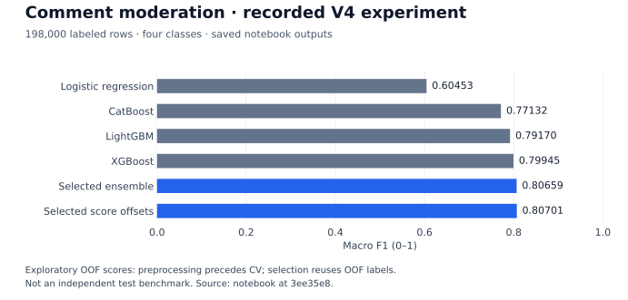

# Jb Anmol

**AI/ML engineering · IIT Madras Data Science**

I work with **Kidaura** on healthcare and behavioral AI. My focus is applied ML systems: data pipelines, PyTorch experiments, evaluation, and interfaces that keep people in control of model outputs.

[**Portfolio ↗**](https://jbanmol.tech) · [LinkedIn](https://linkedin.com/in/jbanmol) · [Email](mailto:jbanmol9@gmail.com) · [Selected work](#selected-work) · [Contributions](#contributions)

Interested in ML / Research Engineer internships and early-career opportunities internationally.

## Selected work

<table>
<tr>
<td width="50%" valign="top">

### Document AI with source evidence

**PO-LICE · team project**

Procurement PDF → cited facts → deterministic checks → human review. My merged contributions cover extraction, upload provenance, and consistency between evidence and the review UI.

[Code & team](https://github.com/Aparna-Jha-05/kaya-ai) · [Demo](https://po-lice.vercel.app) · [My extraction PR](https://github.com/Aparna-Jha-05/kaya-ai/pull/5)

Hackathon prototype with synthetic bids; optional models are disabled by default.

</td>
<td width="50%" valign="top">

### Human review for speech data

**AutoEIT · ASR audit workflow**

Whisper drafts → item-level review → workbook export. The public snapshot contains **120 populated final-transcription fields across 4 audit files**, plus code for item validation and backups.

[Code & limitations](https://github.com/jbanmol/autoeit-asr-human-audit-pipeline) · [Write-back implementation](https://github.com/jbanmol/autoeit-asr-human-audit-pipeline/blob/cba27e2d955abbe5d23106f09d94be2799d3d430/src/03_populate_excel.py)

Artifact completeness, not a measured ASR accuracy or time-saving result.

</td>
</tr>
<tr>
<td width="50%" valign="top">

### Audio classification under shift

**Messy Mashup · PyTorch**

Dynamic stem mixing, log-mel features, ConvNeXt-Nano, and fold ensembling. Inference combines **5 models × 3 crops** when all checkpoints are available.

[Training & inference](https://github.com/jbanmol/robust-audio-genre-classification) · [V8 notebook](https://github.com/jbanmol/robust-audio-genre-classification/blob/32db37c15667720b1de0c4a0349f1f80c8cfc946/v8_kaggle_notebook.ipynb)

Implementation available; no verified V8 test score or released checkpoints.

</td>
<td width="50%" valign="top">

### Imbalanced NLP experiments

**Comment moderation · four classes**

TF-IDF/SVD, sentence embeddings, tree and linear models, and ensemble selection. Saved V4 outputs include **198,000 labeled rows**, per-class reports, and a confusion matrix.

[Methods & results](https://github.com/jbanmol/comment-moderation-nlp-ensemble) · [Recorded notebook](https://github.com/jbanmol/comment-moderation-nlp-ensemble/blob/3ee35e85d2743532da3927989b3c73cdc1f4bfbe/23f1001015-notebook-v4.ipynb)

Exploratory results: preprocessing precedes CV and ensemble selection reuses OOF labels.

</td>
</tr>
</table>

<strong>Watch the document-review workflow</strong> — synthetic demo

Existing walkthrough from the [team repository](https://github.com/Aparna-Jha-05/kaya-ai). It illustrates the prototype; it is not a new live acceptance test.

[Architecture and limitations](https://github.com/Aparna-Jha-05/kaya-ai/blob/main/TECHNICAL.md) · [Latest CI](https://github.com/Aparna-Jha-05/kaya-ai/actions/workflows/ci.yml)

<strong>Inspect the recorded NLP results</strong> — with validation limits

The chart reads saved outputs from the [V4 notebook](https://github.com/jbanmol/comment-moderation-nlp-ensemble/blob/3ee35e85d2743532da3927989b3c73cdc1f4bfbe/23f1001015-notebook-v4.ipynb). TF-IDF, SVD, and scaling are fitted before cross-validation; weights and score offsets are selected on the same out-of-fold predictions. These numbers describe that run, not unbiased generalization or a leaderboard result. [Provenance and regeneration](EVIDENCE.md)

## Contributions

| Contribution | Evidence |
|---|---|
| **PO-LICE:** deterministic-first extraction with validated model candidates | [Merged PR #5](https://github.com/Aparna-Jha-05/kaya-ai/pull/5) |
| **PO-LICE:** immutable upload provenance, retry idempotency, and page evidence | [Merged PR #9](https://github.com/Aparna-Jha-05/kaya-ai/pull/9) |
| **PO-LICE:** align 3D constraint displays with backend evidence | [Merged PR #35](https://github.com/Aparna-Jha-05/kaya-ai/pull/35) |
| **ADHD agent tooling:** practical CLI / SDK quickstart | [Merged documentation PR #31](https://github.com/UditAkhourii/adhd/pull/31) |

Additional engineering investigation

[Hermes #15523](https://github.com/NousResearch/hermes-agent/pull/15523) adds regression tests for local-provider HTTP timeout policy and explicit overrides. **Closed without merge**; included as a debugging contribution, not an accepted upstream fix.

**Core tools:** Python · PyTorch · scikit-learn · SQL · FastAPI · TypeScript

Healthcare work is introduced on [my portfolio](https://jbanmol.tech). The projects above link to public evidence; no private clinical results are used as public benchmarks.
